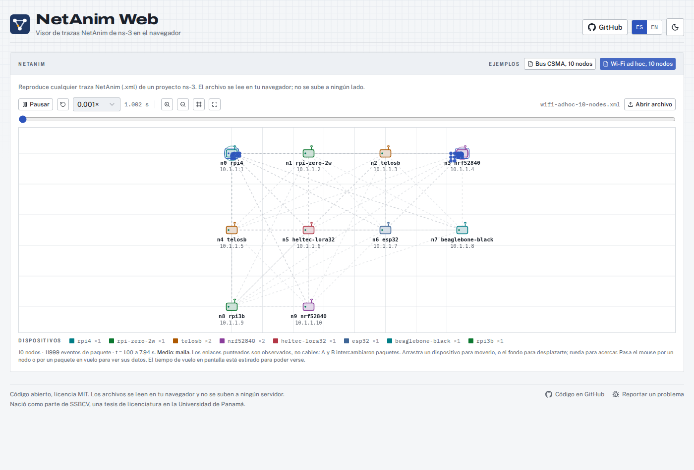

# NetAnim Web

Play [ns-3](https://www.nsnam.org/) NetAnim traces (`anim.xml`) in the browser.
No install, no Qt, no upload: the file is parsed and animated on your machine.



## What it does

- Opens any trace written by ns-3's `AnimationInterface`.
- Plays packets in flight, with a timeline, speeds from 0.001x to 2x, zoom,
  pan, fit-to-view and fullscreen.
- Draws the links the trace declares; when it declares none (Wi-Fi, mesh), it
  draws the links it observed, dashed, so they are not mistaken for cables.
- Colours nodes by their description (for example a device profile name) and
  lists them in a legend.
- Hovering a node or a packet shows its data: addresses, sender, receivers,
  latency.
- Spanish and English, light and dark theme.
- Two example traces are bundled (a CSMA bus and a Wi-Fi ad hoc network, both
  with 10 nodes, from ns-3 3.44).

The desktop NetAnim does more (statistics tables, routing views, packet
filters). This viewer covers playback, which is what most people open NetAnim
for, and it runs anywhere a browser does.

## Run it

```bash
npm install
npm run dev        # http://localhost:3000
npm run build      # static files in dist/, servable from any sub-path
```

Or with Docker:

```bash
docker compose up -d --build   # http://localhost:8090
```

## Producing a trace in ns-3

```cpp
#include "ns3/netanim-module.h"

AnimationInterface anim("anim.xml");
anim.UpdateNodeDescription(node, "gateway");   // optional, shown as the label
```

Then open `anim.xml` with **Open file**.

## Origin

NetAnim Web started as part of SSBCV, a network simulation platform built for
a bachelor thesis at the University of Panama (Centro Regional Universitario
de Veraguas), and was split out as a standalone tool.

## License

[MIT](LICENSE) © 2026 Faustino Aguilar
